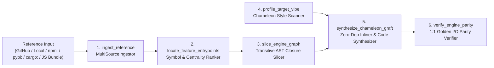

# @kr-pro-labs/clonevibe-mcp

[**English**](./README.md) | [**한국어 (Korean)**](./README.ko.md)

[](https://github.com/KR-PRO-Labs/clonevibe-mcp/actions/workflows/ci.yml)
[](./LICENSE)
[](https://nodejs.org/)
[](https://modelcontextprotocol.io/)

**Surgical AST Feature Slicer, Zero-Dependency Chameleon Code Grafter & 1:1 Golden Parity MCP Server for Vibe Coding.**

During Vibe Coding, engineers frequently discover a specific algorithm, table parser, retry scheduler, physics routine, or state machine buried inside a massive external reference (a 50,000-line GitHub repository, an `npm:`/`pypi:`/`cargo:` package, or a minified JS bundle). Cloning the entire repository or installing bloated dependency trees pollutes your project.

**`clonevibe-mcp`** extracts **only** the minimal transitive AST closure of the target feature, replaces third-party dependencies with lightweight zero-dependency inline micro-shims, adapts the code to your host project's language and style conventions, and mechanically proves 1:1 behavioral equivalence via Golden I/O vectors.

---

## Architecture Pipeline



---

## Key Capabilities

- **All-in-One Multi-Source Ingestion**: Ingests local codebases, GitHub URLs, package registry specs (`npm:`, `pypi:`, `cargo:`), inline file maps, and single-line minified JS bundles (with automatic token-aware structural formatting).
- **Polyglot Transitive AST Closure Slicing**: Extracts top-level functions, classes, structs, interfaces, and call edges across **TypeScript, JavaScript, Python, Rust, and Go**, pruning 80%–98% of unrelated repository boilerplate.
- **Zero-Dependency Micro-Shim Catalog**: Automatically replaces external imports (`lodash`, `uuid`, `axios`, `node-fetch`, `chalk`, etc.) with self-contained standard-library inline primitives (`externalDepCount === 0`).
- **Chameleon Style & Cross-Language Assimilation**: Profiles your workspace (`camelCase` vs `snake_case` vs `PascalCase`, `esm` vs `commonjs`, quotes, indentation, error handling) and synthesizes drop-in modules and Clean-Room Algorithmic Blueprints.
- **1:1 Golden Parity Verification**: Executes empty, numeric boundary, Unicode/CJK, malformed, and deterministic seed Golden Vectors and emits a ready-to-run host unit test file (`vitest`, `pytest`, `cargo test`, or `go test`).

---

## Quick Start & MCP Client Configuration

### Install & Build from Source
```bash
git clone https://github.com/KR-PRO-Labs/clonevibe-mcp.git
cd clonevibe-mcp
npm install
npm run build
npm test
```

### Claude Desktop / Cursor / Windsurf / Antigravity (`mcp_config.json`)
```json
{
  "mcpServers": {
    "clonevibe-mcp": {
      "command": "npx",
      "args": ["-y", "@kr-pro-labs/clonevibe-mcp"]
    }
  }
}
```

---

## MCP Tools Reference

| Tool Name | Description |
| :--- | :--- |
| `ingest_reference` | Hydrates a GitHub URL, local directory, registry spec (`npm:`, `pypi:`, `cargo:`), inline file map, or minified JS bundle into a `ReferenceSnapshot`. |
| `locate_feature_entrypoints` | Scores and ranks symbols in a snapshot against natural-language feature queries and call centrality. |
| `slice_engine_graph` | Computes the minimal transitive AST call/type closure from entrypoint symbols and matches zero-dep shims. |
| `profile_target_vibe` | Inspects a target workspace or code sample to detect language, module system, casing, quotes, indentation, and error-handling idiom. |
| `synthesize_chameleon_graft` | Generates a zero-dependency adapted code module and Clean-Room Algorithmic Blueprint in the target language. |
| `verify_engine_parity` | Verifies 1:1 Golden I/O parity, confirms zero external dependencies, and outputs a runnable test suite. |

## MCP Resources

- `clonevibe://catalog/zero-dep-shims` — JSON catalog of zero-dependency inline shims across TypeScript, JavaScript, Python, Rust, and Go.
- `clonevibe://guide/chameleon-workflow` — Markdown guide for executing the 6-stage surgical grafting pipeline.

---

## License

MIT © [KR-PRO-Labs](https://github.com/KR-PRO-Labs) & [Julian Vane (`@goooem`)](https://github.com/goooem)
